# Salience V4

Salience is a self-hostable, provider-neutral content operating system built around PostgreSQL, Temporal workflows, typed agents, governed artifacts, and replaceable adapters. The V4 blueprint describes the full target architecture. Current application evidence remains bounded to local fixtures; production is not fully integrated or released.

## Current status and evidence

**Initial audit/design checkpoint:** COMPLETE_REVIEWED for frozen source `7c1ddcda280b510048ad61106c406171edd64f18` and environment `18b15955b9a3be547bd1998ac2c1fce759c99d647fc3eeaa0ea21858e7a81436`; five increments REQUIRED; five designs COMPLETE_REVIEWED; implementation and target qualification NOT RUN; 22 final-entry rows remain non-PASS; RG0/RG1 HELD; Slice 7/P2 BLOCKED; production disabled; main unmerged.

The frozen application/artifact candidate is `182c4e43d3666a7c21c22d4d8fa3e8c994e6ce7f`; its final clean non-live run passed **796**, skipped **17**, and emitted **3 warnings**. Candidate-bound image, wheel, runtime, inventory and launch-lock pins are in the [successor evidence addendum](docs/v4/publication-recovery-hold-successor-evidence.json) and [Task 8 report](.superpowers/sdd/2026-10-13-p1-publication-recovery-floor-repair/task-8-report.md). Task 10 candidate `5cb5791` remains unsupported as the rollback floor; the earlier 614-test result remains bound to `7878208`.

The reviewed and pushed feature checkpoint is `6f5edc77edbfe189e46de4254c2fdb21c5652bce`. GPT-6.1 reviewed 59 commits / 38 changed files and found **0 Critical / 0 Important / 1 nonblocking Minor**; GPT-5.6 meta-review accepted that assessment. [Actions run 38592066455](https://github.com/manojvermamv/Salience/actions/runs/38592066455) passed both required jobs, `verify` and `p0-regression`, with **787 passed / 26 expected skips / 3 warnings**. Separately, [Actions run 38610329330](https://github.com/manojvermamv/Salience/actions/runs/38610329330) completed successfully for the exact pushed documentation head `67effe8c9c176c0bd1c17fdef20b841c0e14b6de`; both required jobs passed. Neither hosted result is the application-local qualification: the frozen application candidate `182c4e43d3666a7c21c22d4d8fa3e8c994e6ce7f` remains at **796 passed / 17 skipped / 3 warnings**. The exact audit source-head CI is recorded as Actions run 40443346020 and passed both required jobs for 7c1ddcda280b510048ad61106c406171edd64f18. Formal PR approval is **NOT RUN**; `main` (`8e50d68efbf2bec2aabfb2fe3226e01635de2adb`) remains unmerged. The user-approved program sequence records Slice 1's initial audit and five bounded design evaluations as COMPLETE_REVIEWED only for the frozen source/environment. Documentation whole-change review is PASS_AFTER_FIX_ROUND_1 for reviewer-reported manifest `cafa0bd46ede2cc8aef51058f46541068a07cd031774c8b5501270bc2385ee9a`; that review does not transfer to later content or exact-candidate CI. The final exact-candidate/environment P1/RG0/RG1 audit remains NOT RUN / BLOCKED. Implementation and target qualification remain NOT RUN. See the [portable review record](docs/v4/p1-rg0-rg1-audit-and-spec-review.md).

The initial residual-gap audit is complete only for source commit 7c1ddcda280b510048ad61106c406171edd64f18 and environment manifest digest 18b15955b9a3be547bd1998ac2c1fce759c99d647fc3eeaa0ea21858e7a81436. Exact-source Actions run 40443346020 passed both required jobs, verify and p0-regression. All five bounded increments are REQUIRED and their designs are COMPLETE_REVIEWED; implementation and target qualification are NOT RUN. All 22 audit rows are non-PASS for final entry because the target environment, named accountable owners, and current external acceptance evidence are missing or stale. RG0 and full RG1 are HELD, and P2 is BLOCKED. Slice 1 is complete only as this frozen initial inventory; Slice 7, the final exact-candidate/environment audit, has not run. Production effects remain disabled, the fixture publication budget is zero, formal PR approval is NOT RUN, and main remains unmerged.

- [Production policy and cross-service revocation design](docs/superpowers/specs/2026-10-13-p1-production-policy-and-revocation-design.md) — REQUIRED; COMPLETE_REVIEWED; implementation and target qualification NOT RUN.
- [Production routing and worker fencing design](docs/superpowers/specs/2026-10-13-p1-production-routing-and-worker-fencing-design.md) — REQUIRED; COMPLETE_REVIEWED; implementation and target qualification NOT RUN.
- [Live Temporal schedule inventory and fencing design](docs/superpowers/specs/2026-10-13-p1-live-schedule-fencing-design.md) — REQUIRED; COMPLETE_REVIEWED; implementation and target qualification NOT RUN.
- [Production recovery, remote read reconciliation, and alerts design](docs/superpowers/specs/2026-10-13-p1-production-recovery-and-alerts-design.md) — REQUIRED; COMPLETE_REVIEWED; implementation and target qualification NOT RUN.
- [External RG0/RG1 acceptance design](docs/superpowers/specs/2026-10-13-rg0-rg1-external-acceptance-design.md) — REQUIRED; COMPLETE_REVIEWED; implementation and target qualification NOT RUN.

The corrected-publication rereview returned `NO_FINDINGS_WITHIN_REVIEWED_FIXTURE_CORRECTION_SCOPE` for application `a4b2368cdb463939d093020224a5b5667392aee6`, with documentation and observed HEAD `d0311725686d81b7b4747c2d6225986e5ea3a524`; its meta-review returned `ACCEPT`. That review covers only its A4 correction scope and does not review candidate `182c4e4` or qualify production routing/effects.

**Historical publication qualification:** `a4b2368cdb463939d093020224a5b5667392aee6` passed **21 focused / 604 full non-live tests**, with **352 source hashes**, for the original legacy intelligence, selected-brief, no-send dummy, dry-creative, governed-publication stages and both original native schedule conversions. It used isolated fixtures, a zero publication budget and disabled effects. See the [historical application evidence](docs/v4/legacy-publication-evidence.json).

**Historical published checkpoint and CI:** `a2e73c7242d67388e8cd3be4361283cd8e6c081a` was the published feature/documentation checkpoint. [CI run 37346137016](https://github.com/manojvermamv/Salience/actions/runs/37346137016) passed `verify` and `p0-regression` for that checkpoint; `p0-regression` reported **604 passed** and **three warnings**. This is not a CI result for `7878208`.

The parallel-agent extension is a separate fixture qualification at `2653d2ecb3f0d5bb8ea6560de274137dd6032a96` (**45 focused / 540 full non-live PASS**, 325 source hashes); RG5 and production scaling/live models remain held. Production effects remain disabled, fixture publication budget is zero, RG0/full RG1 are **HELD**, P2 is **BLOCKED**, P3–P7 remain gated, and optional P6 is disabled. `main` remains unmerged and formal PR approval remains NOT RUN.

| Area | Current evidence | Production status |
| --- | --- | --- |
| Frozen 0043 application candidate | `182c4e43d3666a7c21c22d4d8fa3e8c994e6ce7f`; 796 passed / 17 skipped / 3 warnings in the final clean non-live run | Candidate-scoped local fixture qualification; effects disabled; RG0 and full RG1 are **HELD** |
| Reviewed and pushed feature head | `6f5edc77edbfe189e46de4254c2fdb21c5652bce`; GPT-6.1 0/0/1 Minor, GPT-5.6 meta-review accepted; Actions run 38592066455 passed both required jobs (787/26/3) | Formal PR approval **NOT RUN**; `main` is unmerged |
| Latest pushed documentation head | `67effe8c9c176c0bd1c17fdef20b841c0e14b6de`; Actions run 38610329330 completed successfully, with `verify` and `p0-regression` passed | Docs-only CI; no application test counts attributed |
| Initial audit source head | 7c1ddcda280b510048ad61106c406171edd64f18; Actions run 40443346020 passed verify and p0-regression | Audit execution complete for the frozen source/environment; formal PR approval NOT RUN, main unmerged |
| Main branch | `8e50d68efbf2bec2aabfb2fe3226e01635de2adb` | Unmerged; formal independent PR approval remains NOT RUN |

Green status means implemented and qualified in local fixture scope; it does not mean production-ready. Production effects remain disabled, RG0/full RG1 remain held, and production is not fully integrated or released.

## V4 target architecture

The two diagrams use one status key: green solid is implemented and qualified in local fixtures; amber marks held or disabled boundaries; blue dashed is planned target flow that is not wired or enabled; gray is reference-only. Local test qualification does not establish production readiness.

An approved creative decision is immutable: a changed governed decision creates a new distribution and ready-package version. `ReadyToPublishPackage@v1` is the only valid Phase-9 publishing input; V4 also requires the current account-bound request and G3 permit.

```mermaid
flowchart TB
  subgraph legend["Status legend"]
    LGREEN["Implemented / qualified in local fixture scope"]
    LAMBER["Held / disabled boundary"]
    LBLUE["Planned target flow; not wired or enabled"]
    LGRAY["Reference-only"]
  end

  subgraph runtime["SALIENCE RUNTIME BOUNDARY"]
    subgraph fixture["CURRENT LOCAL FIXTURE LANE — no production effects"]
      PEOPLE["Operator or program owner"]
      SCHEDULES["Separately qualified local schedule"]
      SIGNED["Signed fixture API / SDK / CLI"]
      GOVERN["Scope, current grants, stop revision,<br/>baseline, policy and admission"]
      BIND["Immutable goal, intent, cycle,<br/>context and operation binding"]
      STORE["PostgreSQL transaction:<br/>canonical state + outbox / inbox"]
      DISPATCH["Ordered token-fenced dispatcher"]
      TEMPORAL["Temporal control workflow<br/>and compatible worker"]
      SELECT["Dispatch exactly ONE stage<br/>from the immutable binding"]
      INTEL["Original intelligence / selected-brief variant"]
      DUMMY["No-send dummy stage"]
      CREATIVE["Dry creative stage"]
      NO_PACKAGE["No media asset or ready package"]
      READY["Separately supplied exact<br/>ReadyToPublishPackage@v1"]
      PUB["Governed publication stage:<br/>account + approval + budget bindings"]
      FIXTURE_PUBLISHER["Internal fixture publisher<br/>zero budget; effects disabled"]
      EXPIRED["Retry / submit readback:<br/>accepted or processing receipt + expired permit"]
      CANCELLED["Cancellation readback:<br/>fixture receipt is already published"]
      HOLD["Immutable 0042 / 0043 hold row<br/>21-key v1 liability snapshot + SHA-256 fingerprint"]
      TYPED_HOLD["Non-retryable LegacyPublicationRecoveryHeld<br/>no business-success projection;<br/>typed recovery required; no automatic resume"]
    end

    subgraph parallel["SEPARATE PARALLEL-AGENT FIXTURE LANE"]
      TEAM_COMMAND["Separate signed agent-team<br/>API / SDK / CLI entry"]
      TEAM_WORKER["Dedicated parallel-agent worker"]
      CLAIMS["Shared PostgreSQL claims"]
      CHILDREN["Bounded read-only children<br/>16 tasks / team; concurrency 8 / team,<br/>16 / workspace; 300-second deadline; zero spend"]
      LINEAGE["Canonical parent / child lineage"]
      DIRECT["Direct fixture callable entry"]
      RUNNER["LeadContentAgent / TeamRunner"]
      DIRECT_CHILDREN["Bounded independent child calls"]
      TEAM_EVIDENCE["Separate qualification at 2653d2e:<br/>45 focused / 540 full non-live PASS<br/>RG5 and production scaling remain held"]
    end

    subgraph target["FUTURE TARGET — P2–P7 gated / planned"]
      EFFECT_GATE["Production effects gate closed<br/>RG0 and full RG1 HELD"]
      CONTENT["Target content stages"]
      DERIVATIVES["Immutable platform derivatives<br/>account-scoped package versions"]
      YOUTUBE["YouTube private adapter exists;<br/>disabled / unverified;<br/>transfer, processing, readback and<br/>independent live qualification pending"]
      INSTAGRAM["Instagram official API publisher<br/>and analytics adapters planned"]
      LINKEDIN["LinkedIn official API publisher<br/>and analytics adapters planned"]
      OPTIONAL_PLATFORMS["TikTok / future providers<br/>optional extension candidates"]
      READ_ANALYTICS["Separate read-only provider<br/>analytics adapters — P3 / RG3 gated"]
      METRICS["Raw + normalized observations;<br/>versioned metric mappings and cursors"]
      ATTRIBUTION["Deterministic outcomes, attribution<br/>and correction lineage"]
      PROPOSAL["Advisory LearningProposal@v1<br/>no control authority"]
      EXPERIMENT["Gated experiment assignment<br/>and exposure — P4 / RG4"]
      POLICY["Independent cadence and<br/>control policy boundary"]
      RELEASE["Audited strategy / capability<br/>release — P5 / RG5"]
      TRAINING["Optional P6 training<br/>disabled"]
      OPS["Production operations, restore<br/>and rollout remain held"]
    end
  end

  subgraph reference["OUTSIDE SALIENCE RUNTIME"]
    AGENTTUBE["AgentTube pinned source-inspection reference only<br/>No Salience runtime, dependency, schema or wholesale port.<br/>Native reimplementation requires comparison, provenance / license review,<br/>owning-phase approval and P1 / RG0 / RG1 gates."]
  end

  PEOPLE --> SIGNED
  SIGNED --> GOVERN
  SCHEDULES --> GOVERN
  GOVERN --> BIND
  BIND --> STORE
  STORE --> DISPATCH
  DISPATCH --> TEMPORAL
  TEMPORAL --> SELECT
  SELECT --> INTEL
  SELECT --> DUMMY
  SELECT --> CREATIVE
  CREATIVE --> NO_PACKAGE
  SELECT --> PUB
  READY --> PUB
  PUB --> FIXTURE_PUBLISHER
  FIXTURE_PUBLISHER -->|"expired-permit recovery receipt"| EXPIRED
  FIXTURE_PUBLISHER -->|"cancel readback is published"| CANCELLED
  EXPIRED --> HOLD
  CANCELLED --> HOLD
  HOLD --> TYPED_HOLD
  TEAM_COMMAND --> TEAM_WORKER
  TEAM_WORKER --> CLAIMS
  CLAIMS --> CHILDREN
  CHILDREN --> LINEAGE
  DIRECT --> RUNNER
  RUNNER --> DIRECT_CHILDREN
  DIRECT_CHILDREN --> LINEAGE
  CLAIMS -.->|qualification record only; not a runtime output| TEAM_EVIDENCE
  EFFECT_GATE -.-> CONTENT
  CONTENT -.-> DERIVATIVES
  DERIVATIVES -.-> YOUTUBE
  DERIVATIVES -.-> INSTAGRAM
  DERIVATIVES -.-> LINKEDIN
  DERIVATIVES -.-> OPTIONAL_PLATFORMS
  YOUTUBE -.-> READ_ANALYTICS
  INSTAGRAM -.-> READ_ANALYTICS
  LINKEDIN -.-> READ_ANALYTICS
  OPTIONAL_PLATFORMS -.-> READ_ANALYTICS
  READ_ANALYTICS -.-> METRICS
  METRICS -.-> ATTRIBUTION
  ATTRIBUTION -.-> PROPOSAL
  PROPOSAL -.-> EXPERIMENT
  POLICY -.-> EXPERIMENT
  EXPERIMENT -.-> RELEASE
  POLICY -.-> RELEASE
  RELEASE -.-> TRAINING

  classDef local fill:#e4f3e7,stroke:#347a46,color:#173b20
  classDef held fill:#ffe8d8,stroke:#b45b18,color:#572b0c
  classDef planned fill:#e6efff,stroke:#3b67a0,color:#193354,stroke-dasharray:5 5
  classDef reference fill:#eeeeee,stroke:#777777,color:#333333
  classDef legend fill:#ffffff,stroke:#777777,color:#222222
  class PEOPLE,SCHEDULES,SIGNED,GOVERN,BIND,STORE,DISPATCH,TEMPORAL,SELECT,INTEL,DUMMY,CREATIVE,NO_PACKAGE,READY,PUB,FIXTURE_PUBLISHER,EXPIRED,CANCELLED,TEAM_COMMAND,TEAM_WORKER,CLAIMS,CHILDREN,LINEAGE,DIRECT,RUNNER,DIRECT_CHILDREN,TEAM_EVIDENCE local
  class HOLD,TYPED_HOLD,EFFECT_GATE,YOUTUBE,TRAINING,OPS held
  class CONTENT,DERIVATIVES,INSTAGRAM,LINKEDIN,OPTIONAL_PLATFORMS,READ_ANALYTICS,METRICS,ATTRIBUTION,PROPOSAL,EXPERIMENT,POLICY,RELEASE planned
  class AGENTTUBE reference
  class LGREEN,LAMBER,LBLUE,LGRAY legend
  linkStyle 0,1,2,3,4,5,6,7,8,9,10,11,12,13,14,15,16,17,18,19,20,21,22,23,24,25,26 stroke:#347a46,stroke-width:2px
  linkStyle 27 stroke:#777777,stroke-width:1px,stroke-dasharray:3 3
  linkStyle 28,29,30,31,32,33,34,35,36,37,38,39,40,41,42,43,44,45 stroke:#3b67a0,stroke-width:2px,stroke-dasharray:5 5
```



The solid local path shows admission, immutable identity binding, atomic PostgreSQL state/outbox/inbox writes, ordered delivery, Temporal control and one selected legacy stage. Intelligence/selected brief, no-send dummy, dry creative and governed publication are alternatives; dry creative ends with no package, while publication receives a separate exact ready package and its own account, approval and budget bindings. A fixture receipt that meets either recovery-hold condition produces an immutable liability hold and typed non-retryable result without a success projection. Production recovery workers, live readback, alerts and external-effect recovery remain held.

The parallel-agent lane has a separate signed ingress and worker/claim path. Direct `LeadContentAgent`/`TeamRunner` fixture calls have their own in-process entry; both paths can record scoped parent/child lineage, and neither is a child of the original intelligence workflow. Its 2653d2e evidence remains a separate fixture qualification. AgentTube is shown outside the runtime with no execution or dataflow edge.

The blue dashed rail is target intent only. Each platform adapter is independently gated; YouTube is disabled and unverified, while Instagram and LinkedIn adapters are planned and TikTok/future providers are optional candidates. Read-only analytics feed raw/normalized observations, deterministic outcomes and attribution/correction lineage, then advisory learning proposals and gated experiment exposure. An independent policy boundary controls any later audited release; a learning proposal cannot start a cycle or change a production default.

## Locally qualified governed execution path

This execution view expands the current no-effects fixture path and its publication-recovery exception. The diagrams use the shared legend above: green solid is implemented and qualified in local fixtures; amber marks held or disabled boundaries; blue dashed is planned target flow that is not wired or enabled; gray is reference-only. Local test qualification does not establish production readiness.

```mermaid
flowchart TB
  subgraph legend["Status legend"]
    LGREEN["Implemented / qualified in local fixture scope"]
    LAMBER["Held / disabled boundary"]
    LBLUE["Planned target flow; not wired or enabled"]
    LGRAY["Reference-only"]
  end

  subgraph current["CURRENT LOCAL EXECUTION — fixture scope only"]
    subgraph ingress["Signed and scheduled ingress"]
      CMD["Signed fixture command or qualified local schedule tick"]
      AUTH["Authenticate subject; check current scoped grants,<br/>stop revision, baseline and policy"]
      ADMIT["Admit under current scope and limits"]
      BIND["Bind immutable goal, intent, cycle,<br/>context and operation identity"]
    end

    subgraph durable["Atomic state and ordered delivery"]
      COMMIT["Atomic PostgreSQL commit:<br/>allocation, admission, context and outbox"]
      DB["Canonical PostgreSQL state<br/>transactional outbox and inbox"]
      DISPATCH["Ordered token-fenced dispatcher"]
    end

    subgraph temporal["Canonical Temporal control workflow"]
      CTRL["Compatible control workflow<br/>replay, Continue-As-New and finite execution wait"]
      CONSUME["Consume activity"]
      RECEIPT["Durable inbox receipt committed"]
      PERMIT["Issue and claim fixture permit"]
      STAGECHECK["Recheck current authority, permit, policy,<br/>account, approval, rights and bound stage"]
      SELECT["Dispatch exactly ONE stage selected<br/>by the immutable admitted binding"]
    end

    subgraph stages["Alternative stage branches — one admission per branch"]
      INTEL["Original intelligence workflow"]
      BRIEF["Selected-opportunity variant<br/>produces selected brief"]
      DUMMY["No-send dummy workflow"]
      CREATIVE["Dry creative workflow"]
      NO_PACKAGE["No media asset or ready package"]
      PUB["Governed publication workflow<br/>exact package + account + approval + budget bindings"]
      READY["Separately supplied exact<br/>ReadyToPublishPackage@v1"]
    end

    CASEWAIT["Separate opt-in FixtureWaitDriver / wait workflow<br/>review and case deadlines retain cycle, context and operation"]
    FIXTURE["Internal fixture publisher / mock boundary<br/>zero publication budget; effects disabled"]
    RECORDS["Canonical receipts, liabilities and reservations;<br/>cases, notifications, reconciliation and archive"]
    TRACE["Trace, audit and provenance link identities<br/>across ingress, state, workflow and stage result"]
  end

  subgraph holds["FIRST-CLASS PUBLICATION RECOVERY HOLD OUTCOMES"]
    EXPIRED["Retry / submit readback:<br/>accepted or processing fixture receipt<br/>and original permit is expired"]
    CANCELLED["Cancellation readback:<br/>fixture operation is already published"]
    HOLD_EXPIRED["Immutable 0042 / 0043 hold row:<br/>expired_permit_receipt<br/>21-key v1 liability snapshot + SHA-256 fingerprint"]
    HOLD_CANCELLED["Immutable 0042 / 0043 hold row:<br/>published_during_cancel<br/>21-key v1 liability snapshot + SHA-256 fingerprint"]
    TYPED_HOLD["Non-retryable LegacyPublicationRecoveryHeld<br/>retained identity and liabilities;<br/>no business-success projection; no automatic resume"]
    VERIFY["Fixture restart / verifier only:<br/>both exact reason rows required;<br/>unchanged evidence bytes"]
    PROD_RECOVERY["Production recovery workers, remote readback,<br/>alerts and external-effect recovery HELD"]
  end

  subgraph team["SEPARATE PARALLEL-AGENT LANE — not a legacy workflow child"]
    TEAM_COMMAND["Separate signed fixture API / SDK / CLI command"]
    TEAM_WORKER["Dedicated parallel-agent worker"]
    TEAM_CLAIMS["Shared PostgreSQL worker claims"]
    TEAM_CHILDREN["Bounded read-only children<br/>16 tasks / team; 8 concurrent / team;<br/>16 / workspace; 300-second deadline; zero fixture spend"]
    TEAM_LINEAGE["Canonical scoped parent / child lineage"]
    DIRECT["Direct in-process fixture entry"]
    RUNNER["LeadContentAgent / TeamRunner"]
    DIRECT_CHILDREN["Bounded independent child calls"]
    TEAM_EVIDENCE["Separate 2653d2e fixture qualification<br/>45 focused / 540 full non-live PASS<br/>RG5 / production scaling / live models held"]
  end

  subgraph target["TARGET-ONLY RAIL — not used by current fixtures"]
    TARGET_PACKAGE["Future approved publication package"]
    YOUTUBE["YouTube private adapter exists;<br/>disabled / unverified; processing and readback pending"]
    INSTAGRAM["Instagram official API publisher<br/>and analytics adapters planned"]
    LINKEDIN["LinkedIn official API publisher<br/>and analytics adapters planned"]
    FUTURE["TikTok / future platform candidates<br/>optional; independently gated"]
    ANALYTICS["Separate provider read-only analytics contract<br/>full observation-to-release loop is in overview"]
  end

  REFERENCE["AgentTube reference-only boundary is shown in the overview;<br/>no runtime adapter or execution edge"]

  CMD --> AUTH
  AUTH --> ADMIT
  ADMIT --> BIND
  BIND --> COMMIT
  COMMIT --> DB
  DB --> DISPATCH
  DISPATCH --> CTRL
  CTRL --> CONSUME
  CONSUME --> RECEIPT
  RECEIPT --> PERMIT
  PERMIT --> STAGECHECK
  STAGECHECK --> SELECT
  SELECT --> INTEL
  INTEL --> BRIEF
  SELECT --> DUMMY
  SELECT --> CREATIVE
  CREATIVE --> NO_PACKAGE
  SELECT --> PUB
  READY --> PUB
  BRIEF --> RECORDS
  DUMMY --> RECORDS
  NO_PACKAGE --> RECORDS
  PUB --> RECORDS
  PUB --> FIXTURE
  FIXTURE -->|"expired-permit retry / submit readback"| EXPIRED
  FIXTURE -->|"cancel sees published fixture receipt"| CANCELLED
  EXPIRED --> HOLD_EXPIRED
  CANCELLED --> HOLD_CANCELLED
  HOLD_EXPIRED --> TYPED_HOLD
  HOLD_CANCELLED --> TYPED_HOLD
  HOLD_EXPIRED --> VERIFY
  HOLD_CANCELLED --> VERIFY
  CASEWAIT --> RECORDS
  RECORDS --> DB
  PUB --> TRACE
  CTRL --> TRACE
  RECORDS --> TRACE
  TEAM_COMMAND --> TEAM_WORKER
  TEAM_WORKER --> TEAM_CLAIMS
  TEAM_CLAIMS --> TEAM_CHILDREN
  TEAM_CHILDREN --> TEAM_LINEAGE
  DIRECT --> RUNNER
  RUNNER --> DIRECT_CHILDREN
  DIRECT_CHILDREN --> TEAM_LINEAGE
  TEAM_CLAIMS -.->|qualification record only; not a runtime output| TEAM_EVIDENCE
  TARGET_PACKAGE -.-> YOUTUBE
  TARGET_PACKAGE -.-> INSTAGRAM
  TARGET_PACKAGE -.-> LINKEDIN
  TARGET_PACKAGE -.-> FUTURE
  YOUTUBE -.-> ANALYTICS
  INSTAGRAM -.-> ANALYTICS
  LINKEDIN -.-> ANALYTICS
  FUTURE -.-> ANALYTICS

  classDef local fill:#e4f3e7,stroke:#347a46,color:#173b20
  classDef held fill:#ffe8d8,stroke:#b45b18,color:#572b0c
  classDef planned fill:#e6efff,stroke:#3b67a0,color:#193354,stroke-dasharray:5 5
  classDef reference fill:#eeeeee,stroke:#777777,color:#333333
  classDef legend fill:#ffffff,stroke:#777777,color:#222222
  class CMD,AUTH,ADMIT,BIND,COMMIT,DB,DISPATCH,CTRL,CONSUME,RECEIPT,PERMIT,STAGECHECK,SELECT,INTEL,BRIEF,DUMMY,CREATIVE,NO_PACKAGE,PUB,READY,CASEWAIT,FIXTURE,RECORDS,TRACE,TEAM_COMMAND,TEAM_WORKER,TEAM_CLAIMS,TEAM_CHILDREN,TEAM_LINEAGE,DIRECT,RUNNER,DIRECT_CHILDREN,TEAM_EVIDENCE local
  class EXPIRED,CANCELLED,HOLD_EXPIRED,HOLD_CANCELLED,TYPED_HOLD,PROD_RECOVERY,YOUTUBE held
  class TARGET_PACKAGE,INSTAGRAM,LINKEDIN,FUTURE,ANALYTICS planned
  class REFERENCE reference
  class LGREEN,LAMBER,LBLUE,LGRAY legend
  linkStyle 0,1,2,3,4,5,6,7,8,9,10,11,12,13,14,15,16,17,18,19,20,21,22,23,24,25,26,27,28,29,30,31,32,33,34,35,36,37,38,39,40,41,42,43 stroke:#347a46,stroke-width:2px
  linkStyle 44 stroke:#777777,stroke-width:1px,stroke-dasharray:3 3
  linkStyle 45,46,47,48,49,50,51,52 stroke:#3b67a0,stroke-width:2px,stroke-dasharray:5 5
```



The execution order is command/tick, current subject and grant plus stop/baseline/policy checks, admission and immutable bindings, atomic allocation/admission/context/outbox commit, canonical state, ordered dispatcher, compatible Temporal workflow, consume and durable inbox receipt, fixture permit, current authority/policy/stage checks, then exactly one stage. The stage branches are alternatives. Intelligence can produce a selected brief; dummy sends nothing; dry creative ends without a ready package; publication consumes a separately supplied exact ready package. The opt-in wait driver is separate from dispatcher-to-consume delivery.

The two local exception paths are `expired_permit_receipt` with an accepted/processing fixture receipt and expired permit, and `published_during_cancel` with a published fixture readback. Each writes its immutable 0042/0043 hold row with the full 21-key v1 liability snapshot and SHA-256 fingerprint, then raises non-retryable `LegacyPublicationRecoveryHeld`. Both preserve identity/liabilities and produce no business-success projection or automatic resume. Local restart/verifier rehearsal requires both exact reason rows and unchanged evidence bytes. Production worker routing, remote readback, alerts and external-effect recovery remain held. The separate parallel-agent paths use shared scoped parent/child concepts but do not branch from legacy intelligence. Dashed package-to-platform and analytics edges are target-only; fixture receipts do not flow into live analytics. AgentTube remains reference-only as shown above.

## What is and is not production-ready

The local results qualify specific no-effects fixtures. They do not qualify live providers, real production accounts, nonzero publication budgets, production schedule inventory or routing, production-wide recovery and alert delivery, later-phase records, or a full RG1 release. The application and repository checks answer separate questions: application `182c4e43d3666a7c21c22d4d8fa3e8c994e6ce7f` has the candidate-bound local 796/17/3 result; reviewed branch head `6f5edc77edbfe189e46de4254c2fdb21c5652bce` has the accepted GPT-6.1/GPT-5.6 review chain and successful required Actions run 38592066455 (hosted 787/26/3); pushed documentation head `67effe8c9c176c0bd1c17fdef20b841c0e14b6de` has run 38610329330 with both required jobs passed. These results have distinct commits and scopes. Actions run 40443346020 passed verify and p0-regression for exact audit source 7c1ddcda280b510048ad61106c406171edd64f18. Formal PR approval is **NOT RUN**; `main` is unmerged.

Historical records remain tied to their original scopes: `a4b2368` is the original 21/604/352 local qualification; `a2e73c7` and run `37346137016` are an earlier published checkpoint and its CI; the corrected-publication rereview is limited to application `a4b2368` and documentation/observed HEAD `d031172`; and Task 10 candidate `5cb5791` is unsupported as the rollback floor. None substitutes for the current candidate or exact branch-head evidence.

Production effects remain disabled, fixture publication budget is zero, and RG0/full RG1 are **HELD**. P2 is **BLOCKED**, P3–P7 remain gated, optional P6 remains disabled, and `main` remains at `8e50d68efbf2bec2aabfb2fe3226e01635de2adb` without this feature merged. Production is not fully integrated or released.

## Authoritative V4 documents

- [V4 production implementation blueprint](docs/v4/IMPLEMENTATION-BLUEPRINT.md) — target architecture, implementation state, phases, requirement mappings, rollback, and release gates.
- [Execution progress and checkpoints](docs/v4/progress.md)
- [P0 release ledger](docs/v4/p0-release.json)
- [P1 qualification matrix](docs/v4/p1-qualification-matrix.json)
- [Legacy dispatch contract](docs/v4/legacy-dispatch-contract.md)
- [Historical A4 application qualification evidence](docs/v4/legacy-publication-evidence.json) — the dated 21 focused / 604 full non-live result at `a4b2368`; not the current 0043 candidate.
- [Current 0043 successor qualification evidence](docs/v4/publication-recovery-hold-successor-evidence.json) — frozen local results for candidate `182c4e4` and its historical review/CI captures; the initial audit's exact-source CI is recorded separately below, and production remains held.
- [Approved program sequence](docs/superpowers/specs/2026-10-13-v4-multiplatform-autonomy-program-sequence.md) — Slice 1 initial audit and five design evaluations COMPLETE_REVIEWED at the frozen source/environment; Documentation whole-change review is PASS_AFTER_FIX_ROUND_1 for reviewer-reported manifest `cafa0bd46ede2cc8aef51058f46541068a07cd031774c8b5501270bc2385ee9a`; that review does not transfer to later content or exact-candidate CI. The final exact-candidate/environment P1/RG0/RG1 audit remains NOT RUN / BLOCKED. Implementation and target qualification remain NOT RUN. See the [review record](docs/v4/p1-rg0-rg1-audit-and-spec-review.md).
- [Initial commit-bound P1/RG0/RG1 residual-gap audit](docs/v4/p1-rg0-rg1-initial-gap-audit.md) — frozen at source 7c1ddcda280b510048ad61106c406171edd64f18 and environment digest 18b15955b9a3be547bd1998ac2c1fce759c99d647fc3eeaa0ea21858e7a81436; five increments REQUIRED, all 22 rows non-PASS for final entry.
- Five required COMPLETE_REVIEWED designs: [Production policy and cross-service revocation](docs/superpowers/specs/2026-10-13-p1-production-policy-and-revocation-design.md), [Production routing and worker fencing](docs/superpowers/specs/2026-10-13-p1-production-routing-and-worker-fencing-design.md), [Live Temporal schedule inventory and fencing](docs/superpowers/specs/2026-10-13-p1-live-schedule-fencing-design.md), [Production recovery, remote read reconciliation, and alerts](docs/superpowers/specs/2026-10-13-p1-production-recovery-and-alerts-design.md), [External RG0/RG1 acceptance](docs/superpowers/specs/2026-10-13-rg0-rg1-external-acceptance-design.md). Implementation and target qualification are NOT RUN.
- [Inventory and preservation record](docs/v4/inventory.json)

## Historical and separate qualification records

These records retain their own local-fixture or repository-readback scope; they do not establish production release or CI for this README update.

- [P1 item-7 fixture qualification evidence](docs/v4/item7-evidence.json) — historical qualification at `e49a214`, 132 focused / 507 full non-live tests, implemented-fixture scope.
- [P1 item-7 independent-review summary](docs/v4/item7-independent-review.md) — the same historical fixture-review scope.
- [Parallel-agent operating contract](docs/v4/parallel-agent-contract.md) — a separate callable-agent extension and signed fixture lane.
- [Parallel-agent qualification evidence](docs/v4/parallel-agents-evidence.json) — separate local fixture qualification at `2653d2e`, 45 focused / 540 full non-live tests.
- [Repository-enforcement readback](docs/v4/repository-enforcement-evidence.json) — historical published-base evidence; it does not establish status for this README update.

## Verification and navigation

Run the documentation validator and its built-in tests:

```bash
python3 docs/v4/check.py --self-test
python3 docs/v4/check.py
```

The documentation gate covers 75 mapped obligations, preservation and drift checks, and local links. A protected-main merge also requires exact-head documentation (`verify`) and non-live regression (`p0-regression`) checks plus independent PR approval; the earlier checkpoint readback above does not apply to a later commit.

Existing fixture verification commands remain available:

```bash
bash scripts/verify-phase-9.sh
bash scripts/verify-phases-7-8.sh
bash scripts/verify-browser-evidence.sh
```

The pinned Playwright headless runtime is provisioned locally for tests; a fresh checkout still needs browser installation. Default Compose is for private fixtures; `compose.p0.yaml` is an effects-disabled, isolated qualification profile, not production enablement. Use the blueprint's release gates before exposing ingress or real accounts.

- [Historical archive and restoration instructions](docs/archive/2026-09-22/README.md)
- [Original V4 design sources](docs-new-arch/README.md)
- [Historical Phase 1–9 interactive architecture](docs/salience-phase-1-9.architecture.html)

Historical diagrams describe prior implementation boundaries; the blueprint contains the complete V4 target overview and focused workflows.

<!-- Historical heading anchors retained for incoming links. -->
<a id="salience"></a>
<a id="architecture-at-a-glance"></a>
<a id="what-you-can-rely-on-today"></a>
<a id="a-canonical-operational-core"></a>
<a id="governance-before-effects"></a>
<a id="an-evidence-linked-intelligence-loop"></a>
<a id="governed-creative-production-and-distribution"></a>
<a id="provider-neutral-extensions"></a>
<a id="run-a-safe-demo"></a>
<a id="prerequisites"></a>
<a id="public-control-surface"></a>
<a id="verify-the-intelligence-loop"></a>
<a id="verify-browser-evidence"></a>
<a id="what-is-deliberately-not-here"></a>
<a id="repository-guide"></a>
<a id="design-principle"></a>
