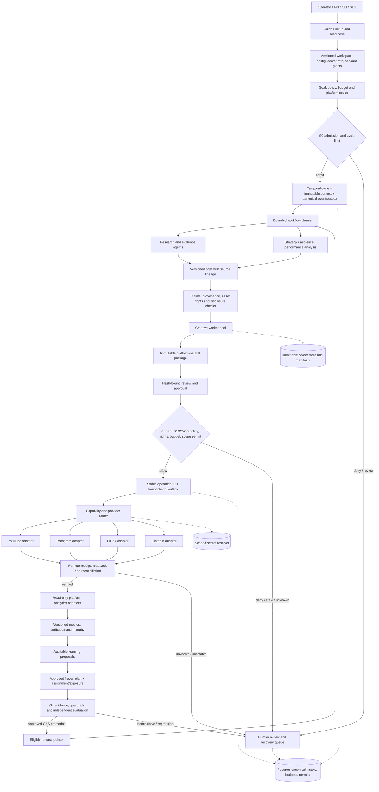

# Salience V4 competitive architecture audit: AgentTube

**Audit date:** 2026-10-12  
**External repository:** `/tmp/youtube-automation-agent-research-20261012`, HEAD `e26792ae00dc1ec2434faf32632896609396dfad`  
**Salience repository:** `/tmp/salience-v4-p1-recovery-20261006`, inspected HEAD `e7a24a38ef920da3af071a51a288b859db9aaef1` (`work/v4-p1-publication-recovery`)  
**Method:** read-only source, tests, design, progress and evidence inspection. I did not run either repository's tests.

## Assessment

AgentTube is a substantially implemented, operator-friendly **single-YouTube-channel product**. It has stronger end-user setup and recovery flows, live YouTube publication and analytics, and already-operational learning and packaging experiments. It is useful product evidence for onboarding, repair/resume, review, and analytics workflows. Its own README says TikTok and Instagram/Reels publishing and analytics are planned, so it is not evidence of a general multi-platform adapter system (`README.md:31-40`; the YouTube-only experiment precondition is also explicit in `utils/growth-experiment-service.js:35-53`).

Salience is stronger as a governed multi-tenant workflow substrate and as a target architecture: typed platform-neutral publication contracts, scoped authorization, durable identity/outbox/permit concepts, structured rights and provenance, durable Temporal execution, and gated experiment/provider release designs. Much of this is a **fixture-qualified implementation or blueprint**, not production capability. Salience currently has no qualified production effects: preserve effects disabled, zero publication budget, RG0/RG1 HELD, `main` unmerged, P2–P7 gated, and P6 disabled (`docs/v4/progress.md:3-5,82-87`; `docs/v4/publication-recovery-hold-evidence.json:302-317`).

There is an evidence-boundary issue to resolve before treating local qualification as current-head qualification. The inspected Salience HEAD is `e7a24a3`; the progress, blueprint, qualification matrix, and recovery evidence identify application candidate `7878208` as the qualified source, and explicitly say current-head CI/formal PR approval is not established (`docs/v4/progress.md:5,14-25`; `docs/v4/IMPLEMENTATION-BLUEPRINT.md:3-11`; `docs/v4/p1-qualification-matrix.json:832-845`). The local `7878208..HEAD` diff includes source and test changes, so the documented 116 focused / 614 full non-live results must not be attributed to `e7a24a3` without the planned exact-head review and verification. Resume at Task 10 and the first open P1 obligation; do not replay completed P0/P1 work (`docs/v4/progress.md:82-87`).

## Capability matrix

Status key: **Implemented** means source-backed behavior exists in the inspected repository; it does not imply independent execution or production qualification. **Partial** means a contract or fixture exists but important runtime or release work remains. **Planned** means present in V4 design/roadmap, not current product behavior. **Missing** means no corresponding general capability was found in the inspected scope.

| Capability | AgentTube at `e26792a` | Salience at `e7a24a3` | Gap and recommendation |
|---|---|---|---|
| **Setup and auto-configuration** | **Implemented, product-level.** The walkthrough guides provider choice, tests credentials, and configures YouTube OAuth; readiness performs bounded text/narration/channel/media probes, with paid image/video probes separately opted in (`README.md:52-74`; `walkthrough.js:151-198,245-320,350-383,389-478`). Provider discovery can use configured credentials or the first matching environment key (`utils/ai-text-service.js:60-88`). This is guided setup and readiness, not automatic creation of third-party credentials. | **Partial, operator/deployment-level.** Typed settings are loaded from environment and store secret references; the application accepts fixture or isolated P0 mode and rejects unqualified production mode (`src/salience/config.py:1-18,26-60,63-116`; `src/salience/api/app.py:50-90`). There is no comparable end-user connection wizard or account-specific readiness center. | Adopt a staged onboarding experience: discover supported capabilities, collect explicit provider/account choices, validate scopes and quotas, and return a signed configuration/readiness report with remediation. Keep secret material in the resolver. Probes must be read-only or explicitly private/sandbox and must never activate effects. |
| **Platform adapters** | **Implemented for YouTube; other social platforms planned.** The actual publishing/scheduling agent uses the YouTube API and holds unknown upload outcomes for reconciliation; TikTok and Instagram/Reels adapters are described as planned (`README.md:38`; `agents/publishing-scheduling-agent.js:101-197,199-250`). | **Partial.** Platform-neutral `PublisherAccount`, `PublisherConnection`, capability profile, request, receipt, and adapter protocols exist (`src/salience/publication/contracts.py:26-73,75-135,178-201`). Registry resolution fails closed on disabled/unverified/incompatible platform, missing scope, visibility, quota, or health (`src/salience/publication/registry.py:14-67`). The YouTube adapter creates a private resumable session but generic submit deliberately errors until an edge uploader streams bytes; status/cancel/webhook handling is incomplete and live smoke is NOT RUN (`src/salience/publication/youtube.py:1-6,142-190,207-340`). Instagram and LinkedIn are P2 work, not implemented (`docs/v4/IMPLEMENTATION-BLUEPRINT.md:373-383`). | Keep the platform-neutral contract and implement each platform as an independently qualified adapter with capability/version, account-grant and remote-readback evidence. No platform's support should be inferred from a generic interface. |
| **Provider routing** | **Implemented, ergonomic and permissive.** Text providers can be selected through credentials or discovered from environment; video `auto` selects the first available compatible provider, while an unavailable explicitly requested provider silently falls back to local slideshow (`utils/ai-text-service.js:60-88`; `utils/video-providers.js:419-445`). Generation records provider task state before polling and reuses successful artifacts (`utils/media-generation-service.js:19-33,70-111,114-185`). | **Partial.** Salience has an OpenAI-compatible JSON model adapter and records provider/model/version, hashes, trace, usage, latency and cost (`src/salience/models/openai_compatible.py:13-73`; `src/salience/models/recording.py:20-39,64-116,200-214,250-282`). Creative provider selection checks capabilities and constraints (`src/salience/creative/capabilities.py:22-109`), but V4's governed candidate/evaluation/trial/active capability router is P5 (`docs/v4/IMPLEMENTATION-BLUEPRINT.md:409-418`). | Adopt guided provider setup and visibility of chosen provider, model, cost, and job state. Do not adopt silent substitution. Require policy-approved routing and fallback, contract compatibility, fingerprints, observed cost, and a recorded deviation when actual routing differs from plan. |
| **Autonomous orchestration and worker parallelism** | **Implemented but local and sequential.** The operator persists plan/run state and resumes unfinished work, permits one active run, then awaits plan items in a serial loop (`utils/autonomous-channel-operator.js:15-70,73-93,94-167`). Schedules run through `node-cron` after `npm start` (`schedules/daily-automation.js:1-108`; `README.md:359-382`). The operator is autonomous in channel planning, but it is not a general distributed multi-worker planner. | **Partial implementation; stronger substrate.** Temporal workflows, canonical identity/outbox, durable cycles, and bounded local independent fan-out exist. The parallel-team contract caps work at 16 tasks, concurrency 8, timeout 300s, and spend exactly zero; current teams admit only enabled read/none/pure agents (`src/salience/agents/parallel_contracts.py:1-30`; `src/salience/agents/teams.py:26-53`). Progress explicitly says this is a local fixture extension; automatic infrastructure scaling and effectful/paid team qualification remain held (`docs/v4/progress.md:35-36`; `docs/v4/parallel-agent-contract.md:3-15,17-67`). | Adopt the visible, resumable run/plan experience and independent task status. Build multi-worker execution on Temporal queues and canonical parent/child lineage, with bounded fan-out and per-task leases. Keep effectful work behind durable permits/outbox and current authorization; worker auto-scaling is a later operations qualification, not a side effect of agent autonomy. |
| **Rights, factual provenance, and lineage** | **Implemented at a practical editorial level.** Verified URLs and source-supported claims are recorded; unsupported claims block and waivers require reviewer notes (`utils/provenance-service.js:3-23,36-119`). Approval requires factual review and a `rightsConfirmed` flag (`index.js:1727-1749`); uploaded assets require explicit confirmation (`README.md:84-108`). | **Stronger structured model.** Rights context carries license, consent, likeness, voice, restrictions, territory/channel, commercial use, expiry and revocation IDs (`src/salience/creative/contracts.py:47-64`). Rights policy fails closed on missing/inactive/revoked/expired or out-of-scope consent (`src/salience/creative/governance.py:33-69`); repository records asset provenance/manifests and lineage (`src/salience/creative/repository.py:377-440,606-643`), with integration coverage for consent and C2PA blockers (`tests/integration/test_creative_rights_provenance.py:95-143,146-204`). | Borrow the usable evidence desk and claim-by-claim reviewer flow. Keep the richer typed, asset-linked rights graph as canonical authority; a single boolean should remain a human attestation, never a substitute for source rights or reauthorization at dispatch. |
| **Recovery and idempotency** | **Implemented for a local production lifecycle.** Stage checkpoints validate artifacts, reuse completed work, and perform bounded retry; operator resumes unfinished plan items (`utils/generation-recovery-service.js:3-37,39-75,78-127`; `utils/autonomous-channel-operator.js:73-167`). Unknown YouTube upload results require channel reconciliation before retry (`README.md:76-80`). | **Stronger canonical design/fixture.** Stable operation identity, outbox ordering, permit checks, reconciliation, liability snapshots, typed holds, and compatible-worker rollback are central to V4. Current evidence advances two recovery-hold reasons in a local fixture only; production recovery workers and broader delivery/revocation behavior remain open (`docs/v4/IMPLEMENTATION-BLUEPRINT.md:133-209`; `docs/v4/progress.md:5,14-25`; `docs/v4/p1-qualification-matrix.json:838-843`). | Adopt AgentTube's operator-facing “resume from first incomplete step” affordance and artifact validation. Preserve Salience's operation-level identity and liability behavior: unknown remote outcome means reconcile/hold, never blind retry or a new operation. |
| **Analytics, learning, and outcomes** | **Implemented for YouTube.** Real 24h/7d snapshots feed channel-specific recommendations; simulated evidence is excluded, missing revenue/cost stays unavailable, and recommendations require approval (`README.md:142-170`; `utils/channel-learning-engine.js:12-43,45-75,150-170,296-383`). Scene-aware retention and comment classification are additional product features (`README.md:166-178`). | **Research intelligence current; channel measurement planned.** Salience normalizes evidence-backed research signals and preserves missing-feature availability (`src/salience/intelligence/signals.py:13-65,68-102`) and has a durable research/evidence workflow (`src/salience/workflows/intelligence.py:93-185`). Cross-platform observation adapters, normalized outcome semantics, attribution and learning proposals are P3 backlog (`docs/v4/IMPLEMENTATION-BLUEPRINT.md:385-395`). | Adopt measurement windows, confidence/provenance display, “unavailable vs zero,” cost/revenue coverage, and human-reviewed recommendations. Do not confuse the current research intelligence loop with post-publication analytics learning. |
| **Experiments** | **Implemented for YouTube packaging.** It requires a published YouTube production and an approved learning source, limits plan arms, separates plan approval/start/winner adoption, restores control after arms, and blocks simulated evidence (`utils/growth-experiment-service.js:35-97,100-135,150-205,208-242`). Evaluation uses CTR, a z threshold, impressions/click floors and retention/traffic-source guardrails (`utils/growth-experiment-service.js:308-357`; `README.md:150-156`). | **Planned, with a stronger release contract.** P4 defines immutable plans, frozen assignments/exposures, statistical review, interference/deviation accounting, promotion by compare-and-swap, and rollback/suspension (`docs/v4/IMPLEMENTATION-BLUEPRINT.md:397-407`; `docs-new-arch/ArchV4-implementation-notes.md:878-918`). | Adopt experiment lifecycle, explicit confirmation, recovery state, and control restoration. Keep Salience's plan to model assignment and actual exposure and account for interference, maturity, sequential/multiple testing, invalidation and rollback. AgentTube's sequential single-video packaging test is useful product behavior, not proof of randomized causal impact. |
| **Review, approval, and safety** | **Implemented product gates.** By default, factual review, media-rights confirmation, quality checks and operator approval precede scheduling; experiment start and adoption need separate confirmation (`README.md:134-140,150-156`; `index.js:1740-1749,1774-1817`). Readiness blocks autonomous work after a blocking probe failure and makes paid probes opt-in (`README.md:66-74`). | **Stronger fine-grained control model; live release held.** Publication reauthorizes the exact workspace/package/account/connection/scopes/destination/locale/territory/visibility, capability, policy, rights, disclosure, approval, budget and quota (`src/salience/publication/governance.py:45-104`). General effect class/scope/budget/approval policy is explicit (`src/salience/governance/policy.py:11-16,47-116`); dry-run does not call the provider (`src/salience/workflows/effects.py:23-35`). Production-wide revocation/general policy/routing remain open (`docs/v4/publication-recovery-hold-evidence.json:302-317`). | Adopt readiness diagnostics and actionable remediation. Preserve authorization at each effect boundary, with narrow permits and revocation checks; a passed setup probe is evidence, not permanent permission. |
| **Multi-platform learning/release operations** | **Missing as a general platform layer.** README calls cross-platform publishing/analytics future work (`README.md:38`); analytics and experiments require YouTube IDs (`utils/growth-experiment-service.js:35-53`). | **Planned.** P2 adds platform adapters; P3 independent analytics adapters; P4 experiment release; P5 capability/provider release; P7 constrains rollout to an isolated account/goal (`docs/v4/IMPLEMENTATION-BLUEPRINT.md:373-440`). | Preserve the dependency order and per-platform evidence. Never report platform-neutral contracts as proof an adapter is live. |

## Where Salience is stronger

Salience has the stronger **governed platform foundation**: canonical workspace/account/connection identities, effect classes, scoped grants, publication permits, budget reservations, durable outbox semantics, immutable receipts and recovery holds. Its publication adapter is not as operationally complete as AgentTube's YouTube uploader, but its contracts model destination, visibility, scopes, capability version, approval and quota explicitly (`src/salience/publication/contracts.py:75-135`; `src/salience/publication/governance.py:45-104`).

Salience is also stronger in rights semantics. AgentTube provides a useful reviewer workflow, but a reviewer boolean cannot express per-asset rights, purpose, territory, expiry, revocation, likeness, voice, or permitted channel. Salience already represents those facts and ties them to assets and distribution lineage (`src/salience/creative/contracts.py:47-64`; `src/salience/creative/repository.py:377-440,606-643`).

For long-running orchestration, Salience has the better base for durable multi-worker execution: Temporal workflows, canonical persistence, ordered outbox and bounded fan-out are aligned with restart and replay. Its current local fan-out is deliberately read-only and zero-spend, however; it must not be described as a qualified autonomous production team (`src/salience/agents/parallel_contracts.py:12-20`; `src/salience/agents/teams.py:30-53`; `docs/v4/progress.md:35-36`).

Salience's design explicitly protects learning and releases from silently changing behavior: evidence lineage, “missing is not zero,” gated trial/promotion, frozen experiment assignment, version eligibility, and compare-and-swap rollback are in the V4 notes/blueprint (`docs-new-arch/ArchV4-implementation-notes.md:87-101,862-918`; `docs/v4/IMPLEMENTATION-BLUEPRINT.md:385-418`). These remain target requirements, not completed production capabilities.

## Concepts to adopt from AgentTube

- A guided setup that turns provider/account configuration into a visible readiness checklist with precise repair instructions. Ask for explicit platform, account, scopes, model/provider, spend cap and objective; show which checks are live and their cost before the operator runs them.
- A durable operator console with plan/run progress, stage checkpoints, resume and “repair only this scene/artifact” actions. Keep artifact validation and downstream invalidation when an upstream input changes.
- A review desk that links claims to evidence, surfaces missing evidence and reviewer decisions, separates factual review from rights confirmation, and carries those decisions into the scheduled package.
- Read-only analytics snapshots with comparable maturity windows, confidence and source coverage. Distinguish missing, preliminary, simulated, unavailable, and real values. Show ROI only when both revenue and cost evidence support it.
- Experiment state transitions that are legible to operators: draft → approved → activated → measuring → restored control → result → separately approved adoption. Notify and require recovery when restoration fails.
- Provider readiness probes and remediation reports, but keep probes scoped, cost-bounded, explicitly activated, non-publishing, and separate from a production effect permit.

## What must not be copied

1. **No silent provider fallback.** AgentTube's requested-provider fallback to slideshow and first-available `auto` selection are convenient for a single-user tool, but they can change quality, disclosure, rights, cost, or contract without a fresh Salience decision (`utils/video-providers.js:435-445`). Salience should deny or use a fallback only when the exact fallback is pre-approved, capability-compatible, budgeted and recorded as a deviation.
2. **Do not copy single-process SQLite/cron as the multi-worker control plane.** AgentTube's schedule starts with `npm start` and uses in-process cron (`schedules/daily-automation.js:1-108`; `README.md:359-382`). Salience's durable Temporal/PostgreSQL/outbox architecture is the appropriate basis for multiple workers, replay, cross-process claims and receipts.
3. **Do not treat the experiment threshold as general causal proof.** The inspected feature rotates packaging arms sequentially for one YouTube video and evaluates a z threshold plus guardrails (`utils/growth-experiment-service.js:150-205,308-357`). Salience must represent actual assignments/exposure, platform-native or randomized methods, contamination/interference, maturity, sequential looks and multiple comparisons before promotion (`docs/v4/IMPLEMENTATION-BLUEPRINT.md:397-407`).
4. **Do not reduce rights authorization to `rightsConfirmed`.** Keep the checkbox-like acknowledgement as a reviewer action only. The authorization decision must still resolve persisted per-asset rights and recheck expiry, revocation, destination and purpose at dispatch.
5. **Do not infer adapter completeness from a working upload or a protocol.** AgentTube is YouTube-specific; Salience's own YouTube implementation currently prepares a session but rejects generic submit without the edge upload handoff (`src/salience/publication/youtube.py:265-288`). Each adapter needs its own tested upload, readback, interruption, reconciliation, quota, credential-rotation and private/sandbox evidence.
6. **Do not make setup probes production activation.** AgentTube has useful separate opt-ins for paid media probes (`README.md:66-74`); in Salience, checks must not grant publication authority, enable effects, or change RG0/RG1.
7. **Do not let autonomy bypass human or policy gates.** AgentTube itself does not; preserve that lesson. Agent/team output is proposal material, not a self-issued permit, approval or release.

## Generic multi-platform autonomous target architecture

The architecture below generalizes the product workflows without importing YouTube-specific assumptions. It maps to Salience V4's G0–G5 and P2–P7 contracts; the diagram is a target, not a claim of deployed behavior (`docs-new-arch/ArchV4.mermaid:1-8,10-49,51-120`).

Key invariants:

- **Configuration:** onboarding creates versioned desired configuration and references secrets; it never copies raw secrets into workflow history. It validates account scopes, adapter capabilities, provider compatibility, budget, supported media, disclosure, and current authorization before declaring ready. A readiness probe records evidence and expiry; it cannot enable effects.
- **Provider routing:** publisher adapters and model/creative providers are separate registries. Resolve only among enabled, verified, compatible versions that satisfy scope, quality, cost, safety and region constraints. Record planned and actual provider/model/version/fingerprint, cost, and deviations. Fallback is explicit and policy-approved.
- **Workers:** a durable parent workflow creates bounded, idempotent child tasks with scoped inputs, deadlines, concurrency limits, retry contracts and cost ceilings. Read-only research and independent evaluations may fan out; publication, account mutation, spend, experiment activation and strategy promotion require separate permits and approval. Worker death must leave a replayable task or a typed unknown state.
- **Rights and provenance:** represent source, claim, asset, license, consent, transformations, intended platform/destination/territory, synthetic-media disclosures, expiry and revocation as linked records. Bind approvals to immutable content/package hashes and re-evaluate rights immediately before external dispatch.
- **Effects and recovery:** atomically store the logical effect, budget liability, stable idempotency key, outbox event and permit. Platform adapters declare retry/idempotency horizon, status/readback and cancellation semantics. On timeout after submission, reconcile the same operation; if truth remains unknown, preserve liabilities and hold for review instead of resubmitting.
- **Analytics and learning:** analytics adapters are read-only and platform-specific; normalize metric definitions, windows, units, maturity, pagination, missingness and source lineage. A learning service may create proposals only. It never edits cadence, budget, model route, content, or active release pointer itself.
- **Experiments and review:** freeze hypothesis, baseline, eligibility, sample size, method, assignment, actual exposure, stopping rules, guardrails, windows and rollback before activation. Evaluate mature evidence; label inconclusive/invalid results explicitly. Promotion uses human authorization plus versioned compare-and-swap; restore or suspend on regressions. Review and recovery queues have owners, deadlines, alerts and immutable decisions.
- **Safety and operations:** keep kill/stop controls, scoped credentials, quotas, cost caps, isolated worker queues, audit traces, retention controls, backup/restore tests and external alerts. Roll out one isolated goal/account only after every required gate has current evidence.

## Staged roadmap with current gates preserved

This is a sequencing recommendation inside the existing blueprint. It does not reopen completed P0/P1 work or authorize external effects.

1. **Current handoff: exact-head Task 10 and evidence reconciliation.** Start from inspected HEAD `e7a24a3`; review the post-`7878208` source/test delta, run the active plan's required final local verification on exact HEAD, and refresh evidence only if the results support it. Then take the first unfinished item in the existing P1 queue. Do not repeat P0 or the completed local P1 items. Maintain `SALIENCE_EFFECTS_ENABLED=false`, zero publication budget, unknown liabilities intact, RG0/RG1 HELD, `main` unmerged, P2–P7 gated, and P6 disabled (`docs/v4/progress.md:82-87`).
2. **Close the remaining P1/RG0/RG1 obligations.** Work the current matrix, not a rebuilt P1: production-wide revocation and general policy; production dispatcher/alerts; live schedule inventory and start/signal cutover; supported worker routing, drain and rollback; public API-to-provider outbox; separately scoped remote read-only reconciliation; production typed recovery and R33/R34; external durable alert delivery. The current matrix marks these open (`docs/v4/p1-qualification-matrix.json:838-843`; `docs/v4/publication-recovery-hold-evidence.json:311-317`). Continue effects-disabled qualification until RG0/RG1 owners accept deployment-specific evidence.
3. **P2 / RG2: qualified creative and platform publishing.** Finish the YouTube edge upload/resume/processing/readback path, then implement Instagram and LinkedIn adapters only where official scoped access is available. Validate failures before/during/after upload, expiry, credential rotation, quota and remote truth. Keep fixture deployment available; qualify each real adapter separately and keep unsupported platforms disabled (`docs/v4/IMPLEMENTATION-BLUEPRINT.md:373-383`).
4. **P3 / RG3: analytics and learning proposals.** Implement per-platform read-only analytics adapters, canonical metric/window semantics, attribution, source lineage, missingness, maturity and correction invalidation. Exclude simulated data and require approval for any proposal. This adds measurement; it does not change production behavior (`docs/v4/IMPLEMENTATION-BLUEPRINT.md:385-395`).
5. **P4 / RG4: experiments.** Add frozen assignment and actual-exposure records, supported statistical designs, interference and deviation accounting, mature-evidence evaluation, guardrails, human-approved promotion and compare-and-swap rollback. No experiment may create an extra content cycle or silently change active strategy (`docs/v4/IMPLEMENTATION-BLUEPRINT.md:397-407`).
6. **P5 / RG5: governed provider/capability evolution.** Add candidate/evaluation/trial/active/suspended/retired states, frozen regression suites, capability-specific routing and explicit approved fallbacks. Record actual provider choice and fallback deviation; a new provider does not become default by being configured (`docs/v4/IMPLEMENTATION-BLUEPRINT.md:409-418`).
7. **P6 / RG6 remains optional and disabled.** Only propose purpose-scoped data export/training after rights, lineage, holdout, compute and isolation checks; publication rights never imply training rights. Normal operation must succeed with all training capability disabled (`docs/v4/IMPLEMENTATION-BLUEPRINT.md:420-429`).
8. **P7 / RG7: constrained production rollout.** After RG0–RG5 pass (RG6 only if training is enabled), run end-to-end restart/restore, load/soak, alert, cost and rollback exercises, then enable one isolated goal/account under reviewed caps. Increase scope only with new evidence and approval (`docs/v4/IMPLEMENTATION-BLUEPRINT.md:431-440`).

## Evidence limits

This is a code/design comparison, not an independent security review. The external repository advertises a 46-test system suite (`README.md:27`; `package.json:6-21`; test inventory `test.js:11-69`), but it was not run for this audit. Salience qualification documents report candidate-bound fixture test results, not an exact-current-HEAD run (`docs/v4/progress.md:5,14-25`). Neither repository's README, a passing fixture, nor a protocol declaration was treated as proof of production readiness.
