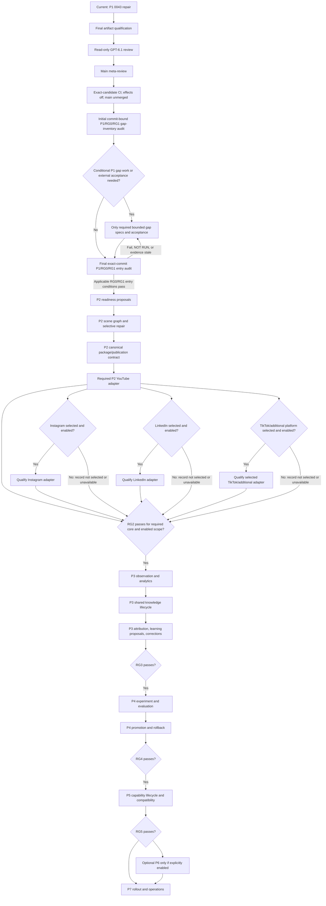

# V4 Multiplatform Autonomy Program Sequence

**Date:** 2026-10-13
**Status:** Draft; user review pending.
**Authority:** Navigation and dependency order only. The [V4 implementation blueprint](../../v4/IMPLEMENTATION-BLUEPRINT.md) remains authoritative for requirements, phase ownership, migration contracts, acceptance, and release gates. This document cannot change or satisfy them.

## Purpose and current boundary

This document gives one dependency-sorted route from the active P1 recovery-floor repair to the governed multi-platform system described by V4. It coordinates separate, phase-owned design and qualification slices; it is not an implementation plan, a combined migration, or permission to cross a gate. A slice contributes only the evidence it actually produces. A phase gate changes only when the blueprint's full applicable requirements and evidence pass.

The current sequence begins with the 0043 publication recovery-floor repair in the [P1 repair design](2026-10-13-p1-publication-recovery-floor-repair-design.md). The [progress ledger](../../v4/progress.md) records the Task 10 candidate and local artifact evidence, while the repair's final artifact qualification, independent read-only GPT-6.1 review, main-agent meta-review, and exact-candidate CI remain completion obligations. Effects stay disabled, the fixture publication budget stays zero, RG0 and full RG1 stay HELD, P2–P7 stay gated, optional P6 stays disabled, and `main` stays unmerged.

The P2–P7 entries below are future specification slots in dependency order. Do not draft or implement a P2 slice until the final exact-commit P1/RG0/RG1 entry audit, after all applicable conditional gap work and external acceptance, reconciles the unchanged candidate and environment and declares the applicable RG0/RG1 entry conditions pass. The earlier audit is a residual-work inventory only. After entry, draft and approve just the next slice's spec; no implementation, migration, provider probe, or effect is authorized by this sequence document.

“Current” means the next bounded work in this sequence, not a claim that a task is running or complete. “Gated” means entry evidence is still required. “Optional” means the slice does not exist unless its explicit enabling decision and conditions are met.

## Program control and shared invariants

Orchestration means a governed logical lead for one program operating through PostgreSQL canonical state, API admission, Temporal workflows, transactional outbox/inbox, and bounded child work. It is not one unrestricted global AI. Model and agent output may propose plans, content, claims, routes, and learning hypotheses; it cannot mint authority, grant a permit, approve its own proposal, change a release pointer, or start an extra cycle.

Every slice preserves these invariants:

- External effects default to disabled. Each platform has separately scoped credentials, accounts, permissions, quotas, and qualification evidence. Missing access is recorded as unavailable or NOT RUN, never inferred.
- Publisher, engagement, creative/model, and read-only analytics capabilities remain separate. Analytics receives no publishing or mutation authority.
- Raw metric names, units, dimensions, windows, timezone, maturity, coverage, pagination, corrections, and missingness are retained. Missing, private, unsupported, preliminary, simulated, and measured zero remain distinct; absence never becomes zero.
- Logical operation identity and idempotency survive retry, restart, continuation, and reconciliation. Unknown remote outcomes reconcile under the original identity or remain held; they never silently become a new operation.
- Learning writes evidence-linked proposals only. Cadence and cycle admission stay independent of observation, learning, evaluation, and promotion.
- Release is gated by the applicable RG evidence and current authority. Rights, provenance, approvals, costs, liabilities, and review evidence bind to immutable object revisions and remain available for correction and rollback.
- Parallel work is bounded, durable, scoped, and auditable. AgentTube remains a pinned reference only; there is no runtime, schema, credential, or dependency coupling.
- The core stays provider-neutral, fallback is never silent, unsupported operations fail closed, and production/RG status is reported exactly as evidenced.

## Sequence overview

The required P2 path reaches the RG2 decision through the canonical contract and YouTube scope, as the current blueprint rollout requires. At that decision, evaluate required core evidence together with every selected/enabled adapter branch; Instagram, LinkedIn, and TikTok/additional-platform work contribute platform-specific evidence only when selected and enabled. Record an unselected or unavailable/NOT RUN disposition and exclude it from enabled-scope acceptance; that status does not block provider-neutral core release unless the user explicitly includes the platform in enabled scope. P6 is omitted unless explicitly enabled, and P7 records RG6 as applicable only when P6 is enabled. The diagram shows order, not current implementation status or automatic release.

## Ordered slices

### 0. Finish the current P1 0043 repair — Current

- **Spec:** [2026-10-13 P1 publication recovery-floor repair](2026-10-13-p1-publication-recovery-floor-repair-design.md), read together with the [2026-10-06 recovery-hold design](2026-10-06-p1-publication-recovery-hold-design.md).
- **Dependencies and entry:** Current P1 candidate and prior evidence from the progress ledger; repair-specific written-spec review before implementation. Preserve the blueprint's active P1 queue.
- **Deliverable:** One exact candidate implementing additive migration 0043, closed v1 liability snapshot, launcher and bytecode trust checks, installed-image Alembic configuration, and authenticated exact migration inventory as specified by the repair design.
- **Minimum acceptance proof:** Complete the repair spec's artifact, preservation, denial, concurrency/crash, migration-inventory, actual-image, focused/full/non-live, documentation, and exact-artifact rehearsal requirements. Obtain read-only GPT-6.1 review, main-agent meta-review, and required CI jobs against the same exact candidate; rerun any invalidated evidence after changes.
- **Migration and rollback:** Follow the 0043 additive migration and forward compatibility floor in the repair spec. Preserve 0042 rows and all liabilities; refuse unsupported or pre-floor workers before registration. No production rollback claim follows from fixture evidence.
- **Exit contribution:** Closes only the repair's specified local fixture obligations, including its applicable R18/R32 evidence. It does not close all P1, RG0, or RG1.
- **Excludes:** Production effects, production routing/restore, gate release, P2 behavior, `main` merge, or any inference from earlier candidate results.

### 1. Initial commit-bound P1/RG0/RG1 gap-inventory audit — Gated

- **Artifact:** A commit-bound audit report and reconciled row status in the existing P1 qualification/evidence records; no new architecture spec is presumed.
- **Dependencies and entry:** Slice 0 complete on the exact audited commit. Read the blueprint, progress, P1 matrix, current source locks, retained evidence, and external qualification records at that commit.
- **Deliverable:** For every applicable P1, RG0, and RG1 obligation, record owner, exact commit/artifact/environment, evidence scope, PASS/FAIL/NOT RUN/HELD, and remaining dependency. Distinguish fixture from production, prior candidate from current candidate, and CI from formal approval.
- **Minimum acceptance proof:** Independent row-by-row reconciliation finds no stale claim, duplicate evidence substitution, missing owner, or silently passed obligation; reviewers can reproduce the status from linked artifacts.
- **Migration and rollback:** No schema change. Preserve immutable historical evidence; correct current pointers through the repository's evidence process without rewriting prior captures.
- **Exit contribution:** Defines the residual P1/RG0/RG1 work and whether each bounded spec below is needed. Any row status is provisional; this inventory cannot declare applicable entry conditions pass.
- **Excludes:** P2 entry, production changes, automatic acceptance, or creating placeholder specs for already-covered obligations.

### 2. Bounded residual P1 policy and revocation spec — Conditional

- **Proposed spec:** `2026-10-13-p1-production-policy-and-revocation-design.md`.
- **Dependencies and entry:** Audit row confirms an uncovered mandatory policy or cross-service revocation obligation; name the exact RG0/RG1 requirement and production owner before drafting.
- **Deliverable:** One bounded current-policy, stop/revocation, and pre-dispatch reauthorization contract for the affected production path, including in-flight operation liability.
- **Minimum acceptance proof:** Tests cover stale, missing, revoked, expired, wrong-scope, and concurrent stop/permit outcomes; production evidence proves an in-flight operation is reconciled under its original identity and no revoked authority issues a new permit.
- **Migration and rollback:** Prefer no schema change; if canonical policy/revocation evidence needs persistence, use an additive migration and retain old decisions. Rollback disables new permits and preserves unresolved operations and liabilities.
- **Exit contribution:** Supplies only its mapped RG0/RG1 rows; the audit records whether they pass.
- **Excludes:** P2 adapter selection, adaptive routing, or production enablement from a policy record alone.

### 3. Bounded production routing and fencing spec — Conditional

- **Proposed spec:** `2026-10-13-p1-production-routing-and-worker-fencing-design.md`.
- **Dependencies and entry:** Audit confirms a remaining production worker-routing, registration, deployment-fencing, or artifact-floor obligation; policy and revocation contracts from slice 2 apply where relevant.
- **Deliverable:** Exact deployment route, worker registration/fencing, compatible artifact floor, ownership, drain, and rollback behavior for existing P1 operations.
- **Minimum acceptance proof:** Exact-candidate tests deny unknown/stale workers before registration, fence duplicate or stale owners, preserve idempotent operation identity across restart, and demonstrate drain and readback against the named environment.
- **Migration and rollback:** Keep artifact/config pins explicit; add schema only for a documented durable routing fact. Rollback disables new routing, drains compatible workers, and retains histories, claims, and liabilities.
- **Exit contribution:** Closes only the mapped routing/fencing rows, contributing to RG0 or RG1 as the audit assigns.
- **Excludes:** Dynamic P5 capability selection, new platform support, or unrestricted worker/agent routing.

### 4. Bounded live-schedule and cutover fencing spec — Conditional

- **Proposed spec:** `2026-10-13-p1-live-schedule-fencing-design.md`.
- **Dependencies and entry:** Audit confirms unresolved live native Temporal schedule inventory, start/signal conversion, cutover, monitoring, or rollback fencing. The local fixture schedule results do not satisfy this entry.
- **Deliverable:** Authorized inventory, pause/readback/cursor rules, stable slot identity, duplicate/coalescing policy, live cutover and rollback fence for the named schedules.
- **Minimum acceptance proof:** Against the exact deployed schedule inventory, show pause/readback before activation; race manual, event, and scheduled requests; prove no duplicate slot/effect after lost acknowledgement, worker restart, stop, or rollback; retain owner and alert evidence.
- **Migration and rollback:** Use additive schedule/cursor evidence if needed. Preserve old and new identities and watermarks; rollback records a pending fence and requires later-slot readback before any old schedule resumes.
- **Exit contribution:** Supplies schedule-specific RG1 evidence only; no fixture-to-production promotion.
- **Excludes:** Changing cadence based on learning, creating new cycles during reconciliation, or converting all legacy schedules by implication.

### 5. Bounded production recovery and alert-delivery spec — Conditional

- **Proposed spec:** `2026-10-13-p1-production-recovery-and-alerts-design.md`.
- **Dependencies and entry:** Audit confirms missing production recovery-worker routing, remote read reconciliation, owner notification, escalation, or alert delivery. Current database notification fixtures are not external alert proof.
- **Deliverable:** Owned recovery cases for unknown or failed effects, least-scope read reconciliation, external alert delivery/acknowledgment, bounded retries, and retained liabilities.
- **Minimum acceptance proof:** Real authorized channel delivery and failure/retry/ack tests; unknown remote outcomes use the same operation ID; stop/revocation races prevent new effects; missing owner, outage, and exhausted retries remain visible and escalated.
- **Migration and rollback:** Add append-only delivery/recovery evidence only if required. Rollback stops new dispatch, retains cases and liabilities, and keeps a compatible read-only reconciliation path where authorized.
- **Exit contribution:** Advances only mapped RG1 recovery/alert rows.
- **Excludes:** Treating notification as approval, automatically resolving a hold, or adding a new platform or analytics adapter.

### 6. External RG0/RG1 acceptance package — Conditional

- **Proposed spec:** `2026-10-13-rg0-rg1-external-acceptance-design.md`.
- **Dependencies and entry:** Draft only if the closeout audit finds external qualifications lack a bounded evidence contract after slices 2–5. The production environment and named owners must be available before execution.
- **Deliverable:** Per-row external environment, authorized operator, exact artifact, prerequisite, command/procedure, result, evidence location, and rollback record for the still-open RG0/RG1 acceptance items.
- **Minimum acceptance proof:** Each required external result is bound to the same candidate/deployment and account scope, independently checked, and classified PASS/FAIL/NOT RUN without transferring evidence across environments or commits.
- **Migration and rollback:** No application migration unless a preceding bounded spec requires one. External qualification rollback restores the previously reviewed configuration and retains audit, evidence, and liabilities.
- **Exit contribution:** Makes the closeout audit capable of declaring the applicable gate status honestly; it does not grant release permission.
- **Excludes:** Enabling production or merging to `main` as a side effect of passing tests.

### 7. Final exact-commit P1/RG0/RG1 entry audit — Gated

- **Artifact:** Final commit-bound audit report and reconciled row status in the existing P1 qualification/evidence records, bound to the final candidate and target environment.
- **Dependencies and entry:** Slice 0 and every required conditional gap or external-acceptance item from slices 2–6 is complete, or explicitly recorded as not applicable. The candidate and environment are frozen for this audit; any change requires affected evidence to be rerun against the final pair.
- **Deliverable:** Reconcile every applicable P1, RG0, and RG1 obligation to the same exact candidate/environment, with owner, evidence scope, PASS/FAIL/NOT RUN/HELD, and remaining dependency. Record the evidence rerun for each item affected by a candidate or environment change.
- **Minimum acceptance proof:** Independent row-by-row reconciliation confirms that the final unchanged candidate/environment is the one covered by current evidence, with no stale claim, duplicate substitution, missing owner, or silently passed obligation. This is the only step allowed to declare applicable RG0/RG1 entry conditions pass. Any FAIL, NOT RUN, HELD, or stale evidence blocks P2 and returns to the applicable gap/acceptance work before this audit is repeated.
- **Migration and rollback:** No schema change. Preserve immutable historical evidence and correct current pointers through the repository's evidence process without rewriting prior captures.
- **Exit contribution:** Records the sole applicable RG0/RG1 entry GO/NO-GO disposition that permits or blocks P2 specification work. It does not approve RG2, production effects, or a release.
- **Excludes:** Treating the initial inventory or conditional gap evidence as entry approval, P2 implementation, automatic acceptance, production changes, or `main` merge.

### 8. P2 readiness and capability proposals — Gated

- **Proposed spec:** `2026-10-13-p2-readiness-capability-proposals-design.md`.
- **Dependencies and entry:** Slice 7's final audit declares the applicable P1/RG0/RG1 entry conditions pass. Trace to R16F, R23F, R25F and blueprint P2 contracts.
- **Deliverable:** Versioned capability manifests plus reviewable configuration/readiness proposals bound to selected platform/account, scopes, media, region, limits, budget, manifest revision, result, expiry, and remediation. Readiness grants no authority or routing.
- **Minimum acceptance proof:** Local/read-only checks report missing grants and incompatibilities; absent/expired/stale readiness cannot issue a permit, enable a route, or clear a gate; secret values never enter evidence records.
- **Migration and rollback:** Add proposal/readiness sidecars only as required, preserving unknown legacy facts. Rollback retires proposals and disables affected capabilities without deleting history.
- **Exit contribution:** Establishes P2 readiness evidence and eligibility inputs; not provider qualification or RG2 closure.
- **Excludes:** Dynamic capability lifecycle (P5), silent provider choice/fallback, and paid or live probes without separate authority.

### 9. P2 scene/content graph and selective repair — Gated

- **Proposed spec:** `2026-10-13-p2-scene-content-graph-repair-design.md`.
- **Dependencies and entry:** Slice 8's reviewed content/readiness contracts and P2 gate entry. Map graph, exact dependency hashes, selective regeneration, and invalidation to R04, R20, R24, and R54 through the blueprint change process.
- **Deliverable:** Versioned graph for evidence, claims, scenes, assets, transformations, reviews, and derivatives; immutable manifests bind hashes, lineage, provider/model, rights, cost, and approvals.
- **Minimum acceptance proof:** Change one upstream node; only its transitive dependents become stale; unaffected verified outputs and reviews remain byte/hash stable. Missing or revoked rights, unsupported provenance, and incomplete media hold publication.
- **Migration and rollback:** Add graph sidecars and compatible readers; never invent historical edges. Rollback stops regeneration and holds unsupported/stale packages while preserving graph versions and source bytes.
- **Exit contribution:** Supplies mapped P2 content and derivative evidence toward RG2.
- **Excludes:** Platform-specific upload, treating a scene hash as approval, and broad regeneration after a local repair.

### 10. P2 canonical package and publication contract — Gated

- **Proposed spec:** `2026-10-13-p2-canonical-package-publication-contract-design.md`.
- **Dependencies and entry:** Slice 9 graph and manifest identities; applicable readiness and authority contracts; blueprint R21/R27/R28/R54/R55.
- **Deliverable:** Provider-neutral package, publication request, operation identity, permit binding, budget liability, adapter semantics, receipt/readback, cancellation, and reconciliation contract. Preserve separate review, rights, and dispatch checks.
- **Minimum acceptance proof:** Contract fixtures cover exact package/destination/account binding, replay, changed-payload conflict, unknown result, idempotency horizon, safe retry, readback, cancellation, cost, and unsupported capability. Unknown state remains held under the original operation.
- **Migration and rollback:** Additive versioned records with old package readers retained. Rollback stops new dispatch and preserves requests, receipts, remote IDs, and unsettled liabilities for reconciliation.
- **Exit contribution:** Establishes the common P2 interface and acceptance boundary; interfaces alone do not qualify any platform or close RG2.
- **Excludes:** Platform-specific semantics in the core, credential sharing across platforms, implicit fallback, and live effect authority.

### 11. Required P2 YouTube adapter — Gated

- **Proposed spec:** `2026-10-13-p2-youtube-publisher-adapter-design.md`.
- **Dependencies and entry:** Slice 10 accepted; fresh YouTube API/scope/quota/policy review; exact account and environment eligibility. The current resumable-session edge is not completed publication evidence.
- **Deliverable:** Complete encrypted session, transfer, resume, processing, remote readback, receipt, correction, and reconciliation path using the canonical contract.
- **Minimum acceptance proof:** Provider contract fixtures cover crashes before/during/after upload, expired sessions, duplicate/lost acknowledgments, quota, processing failure, and identity/readback mismatch. Any private/sandbox/live smoke is separate, explicitly authorized evidence for the named account.
- **Migration and rollback:** Store only scoped encrypted edge-session references and stable remote operation mapping in additive records. Rollback stops uploads, retains sessions/remote IDs, and reconciles before retry or replacement.
- **Exit contribution:** Qualifies YouTube-specific P2 evidence only; contributes to R55/RG2.
- **Excludes:** Treating an accepted upload session as verified publication or generalizing YouTube access/metrics to other providers.

### 12. P2 Instagram adapter — Conditional

- **Proposed spec:** `2026-10-13-p2-instagram-publisher-adapter-design.md`.
- **Dependencies and entry:** Slice 10 accepted; explicit selection for enabled P2 scope and a fresh official API, account grant, media, quota, region, and policy review confirm an implementable capability. Work is skipped and marked unselected or unavailable/NOT RUN when not enabled or access is absent.
- **Deliverable:** Independently scoped Instagram container creation, publication, remote status/readback, and reconciliation against exact package and operation identity.
- **Minimum acceptance proof:** Instagram-specific contract tests cover credential/scope denial, container expiry, duplicate creation, lost acknowledgment, processing/publication status, quota, cancellation limits, and remote mismatch. A private-account smoke, if approved, has separate evidence.
- **Migration and rollback:** Add provider-specific operation/session references without changing the canonical contract; retain container and remote IDs. Rollback disables new calls and reconciles accepted containers before retry.
- **Exit contribution:** Adds Instagram evidence to RG2 only when selected/enabled; unselected or unavailable status is excluded from enabled-scope acceptance and cannot block provider-neutral core release.
- **Excludes:** YouTube token/scope assumptions, LinkedIn behavior, engagement writes, or a required credential for core provider-neutral operation.

### 13. P2 LinkedIn adapter — Conditional

- **Proposed spec:** `2026-10-13-p2-linkedin-publisher-adapter-design.md`.
- **Dependencies and entry:** Slice 10 accepted; explicit selection for enabled P2 scope and a fresh LinkedIn API, organization/account grant, media, quota, and policy review confirm an implementable capability. If Instagram is also selected, retain its independent qualification and semantics; otherwise record it as not selected or unavailable/NOT RUN. Missing LinkedIn access is explicit NOT RUN/unavailable.
- **Deliverable:** Independently scoped LinkedIn media upload and post creation, remote status/readback, and reconciliation against exact package and operation identity.
- **Minimum acceptance proof:** LinkedIn-specific tests cover scoped grant denial, upload/post multi-step crashes, duplicate/lost acknowledgment, processing, quota, cancellation support, and remote mismatch; any private smoke is separate evidence.
- **Migration and rollback:** Persist LinkedIn operation/upload references additively; retain remote IDs and unresolved liabilities. Rollback stops new requests and reconciles before resubmission or adapter replacement.
- **Exit contribution:** Adds LinkedIn evidence to RG2 only when selected/enabled; unselected or unavailable status is excluded from enabled-scope acceptance and cannot block provider-neutral core release. No result transfers from YouTube or Instagram.
- **Excludes:** Sharing credentials or status assumptions with another platform, silent cross-posting, and a required credential for provider-neutral core release.

### 14. P2 TikTok or one additional platform — Optional

- **Proposed spec:** `2026-10-13-p2-conditional-additional-platform-adapter-design.md` (one platform per approved spec; use TikTok only if its fresh review supports it).
- **Dependencies and entry:** Slices 10–11 complete; a new, dated access, policy, capability, quota, rights, and risk review justifies the named platform and the user explicitly selects it for enabled-scope qualification.
- **Requirement mapping (only when selected):** Apply common P2 requirements R21, R22, and R26–R31, plus R55 through a reviewed blueprint extension if the platform is outside R55's current named-provider set. If the platform is unselected or unavailable, record that disposition and exclude its provider-specific evidence from enabled-scope acceptance.
- **Deliverable:** A single platform adapter that conforms to the canonical package/publication contract and owns its isolated credentials, operation identity, policy, status, readback, and reconciliation semantics.
- **Minimum acceptance proof:** Independent provider contract, negative scope/policy tests, crash/idempotency/readback/reconciliation coverage for the mapped requirements, and account-specific evidence when authorized. Core release succeeds with no credential configured for this platform unless the user explicitly includes it in enabled scope.
- **Migration and rollback:** Additive provider-scoped records only; retain remote operation and liability history. Rollback disables this adapter and reconciles in-flight work without changing core eligibility.
- **Exit contribution:** Contributes only the selected platform's mapped requirement evidence to RG2. Its absence or unavailable/NOT RUN status cannot block provider-neutral core release unless the user explicitly includes it in enabled scope.
- **Excludes:** Treating TikTok as an initial or implemented connector, copying another provider's policy, or silently falling back.

### 15. P3 observation and analytics — Gated

- **Proposed spec:** `2026-10-13-p3-observation-analytics-design.md`.
- **Dependencies and entry:** Required P2 package/publication evidence and applicable RG2 acceptance; RG1 only permits explicitly fixture-scoped observation. Recheck metrics, permission scopes, API limits, and retention for each platform.
- **Deliverable:** Independent read-only analytics registry/adapters, raw snapshots/cursors, versioned canonical mappings, windows, maturity, coverage, and correction records.
- **Minimum acceptance proof:** Pagination interruption, duplicate/reordered snapshots, cumulative reset, timezone/unit mapping, private/deleted/unsupported/unavailable and preliminary states all retain meaning; empty responses never become zero; analytics credentials cannot publish.
- **Migration and rollback:** Append-only snapshots and mapping versions; rollback stops collectors at saved watermarks and retains raw history and pending invalidations.
- **Exit contribution:** Supplies observation semantics toward RG3; it does not establish attribution or learning eligibility by itself.
- **Excludes:** Mutation/engagement operations, inferred metrics, and live observation without the required P2/RG2 evidence.

### 16. P3 shared knowledge lifecycle — Gated

- **Proposed spec:** `2026-10-13-p3-shared-knowledge-lifecycle-design.md`.
- **Dependencies and entry:** Slice 15's observation/source envelopes plus existing P2 evidence and knowledge sources; carry the blueprint's R36/R39/R42/R59 traceability into acceptance.
- **Deliverable:** Source and derived knowledge ownership, workspace/program/account scope, version, permitted use and rights, freshness/expiry, citations, supporting/contrary evidence, and bounded correction/revocation dependencies.
- **Minimum acceptance proof:** Multiple agents/cycles reuse only the same authorized fresh version; known identifiers do not permit cross-scope reads; duplicate corrections and restart invalidate dependent summaries/content/proposals within a declared bound without restoring stale eligibility.
- **Migration and rollback:** Add versioned ownership/lineage sidecars; backfill only evidenced facts and mark unknowns. Rollback preserves rights history and source records while excluding stale or revoked projections.
- **Exit contribution:** Establishes reusable authorized evidence for the rest of RG3 and later P5; contributes no authority to retrieval output.
- **Excludes:** A single unrestricted global knowledge store, rights inferred from publication, or automatic content/routing changes.

### 17. P3 attribution, learning proposals, and corrections — Gated

- **Proposed spec:** `2026-10-13-p3-attribution-learning-correction-design.md`.
- **Dependencies and entry:** Slices 15–16; verified P2 receipts/assets/actual costs; canonical metric versions and permitted knowledge lineage.
- **Deliverable:** Deterministic outcomes/attribution, actual cost and conversion certainty, eligible failure/learning events, versioned evidence-linked proposals, and bounded correction propagation.
- **Minimum acceptance proof:** Missing denominator or cost remains unavailable; engagement never implies revenue; corrections invalidate only dependent outcomes/proposals and are idempotent; proposals cannot create cycles, alter cadence, select providers, spend, or promote.
- **Migration and rollback:** Add append-only outcome/proposal and invalidation links; preserve source versions and consumer watermarks. Rollback stops consumers and keeps invalidations pending; it never makes stale evidence eligible.
- **Exit contribution:** Completes applicable P3 evidence only when all RG3 rows pass; provides P4 inputs without authorizing experiments.
- **Excludes:** Self-triggering learning, autonomous strategy updates, causal claims without qualifying exposure, and P4 promotion.

### 18. P4 experiment and evaluation — Gated

- **Proposed spec:** `2026-10-13-p4-experiment-evaluation-design.md`.
- **Dependencies and entry:** RG3 passes; P1 context resolver and authority remain current; frozen evidence, statistical review, maturity, scope, and workload limits are available.
- **Deliverable:** Versioned hypothesis, baseline/treatment, eligibility, assignment unit/probability, actual exposure, deviations, windows, maturity, guardrails, stopping rules, and deterministic evaluation.
- **Minimum acceptance proof:** Golden vectors cover valid, insufficient, inconclusive, invalid, guardrail-failure, missing exposure, confounding, and correction cases; restart and duplicate evidence preserve assignment; evaluation adds no cycle and cannot change defaults.
- **Migration and rollback:** Add immutable plan/assignment/exposure/evaluation records. Rollback stops new assignments and preserves outcomes and pinned runs; restore only a still-eligible baseline.
- **Exit contribution:** Produces reviewed evaluation evidence for RG4; no promotion permission follows.
- **Excludes:** Unbounded experimentation, silent stacking, inferred counterfactuals, and model-calculated authority.

### 19. P4 promotion and rollback — Gated

- **Proposed spec:** `2026-10-13-p4-promotion-rollback-design.md`.
- **Dependencies and entry:** Slice 18 accepted; RG3 correction/invalidation and P1 scoped authority; G4 evidence and rollback target are eligible.
- **Deliverable:** Separate G4b promotion, compare-and-swap pointer update, monitoring, suspension/rollback, and in-flight operation reconciliation.
- **Minimum acceptance proof:** Concurrent promotions yield one authorized CAS winner; stale/revoked evidence denies; invalidation versus promotion races are serialized; rollback selects an eligible version or suspends; remote publication correction is a separate operation.
- **Migration and rollback:** Append promotion/suspension receipts and pointer revisions; never rewrite experiment history or undo remote effects by pointer change. Rollback is a new audited CAS or suspension.
- **Exit contribution:** Supplies the release machinery required for RG4 and P5; RG4 closes only after all applicable requirements pass.
- **Excludes:** Self-promotion, current-pointer changes from candidate registration, or invalidation suppression.

### 20. P5 capability lifecycle and compatibility — Gated

- **Proposed spec:** `2026-10-13-p5-capability-lifecycle-compatibility-design.md`.
- **Dependencies and entry:** RG4 and qualified P2/P3 adapter contracts; shared knowledge scope contract; current independent capability evidence.
- **Deliverable:** Candidate, evaluation-only, trial-eligible, active, suspended, and retired lifecycle; explicit routing/fallback decisions; provider/model/tool/agent/protocol fingerprints and compatibility/deprecation rules.
- **Minimum acceptance proof:** Incompatible/suspended/evaluation-only capability denies production effects; explicit fallback retains scope and is recorded as a deviation; planned/actual version, cost, and routing match evidence; two adapters can be swapped without domain changes and historical data stays readable.
- **Migration and rollback:** Convert enabled legacy profiles only to reviewed candidate or qualified baseline; never infer V4 active approval. Rollback suspends or CAS-routes to an eligible compatible capability while retaining histories and knowledge rights.
- **Exit contribution:** Closes applicable RG5 rows per enabled capability and supports P7 rollout.
- **Excludes:** Training as a prerequisite, boolean-enabled-as-approved shortcuts, and silent substitution.

### 21. P6 optional model adaptation — Optional

- **Proposed spec:** `2026-10-13-p6-optional-model-adaptation-design.md`.
- **Dependencies and entry:** Explicit enablement decision after RG5, RG3 data lineage, purpose-specific rights, supported method/license, isolation, and G5 owner approval. Without that decision, do not write or execute this spec; record P6 disabled.
- **Deliverable:** Purpose-scoped dataset proposal and approval before export/spend, protected splits, isolated training, reproducible candidate artifacts, and cost/revocation handling.
- **Minimum acceptance proof:** Denied or revoked rights, wrong purpose/destination, protected data, disabled mode, or exceeded cap blocks materialization; holdout leakage fails; trained output can register only as a candidate and must pass G4a/G4b.
- **Migration and rollback:** Disabled-by-default additive dataset/run lineage; no automatic history export. Rollback revokes leases, stops work, reconciles cost, and quarantines affected candidates while retaining lawful lineage/tombstones.
- **Exit contribution:** RG6 applies only if enabled; otherwise the standard release path must prove operation with P6 disabled.
- **Excludes:** Publication rights as training rights, automatic data export, or training as a dependency of P7.

### 22. P7 production rollout and operations — Gated

- **Proposed spec:** `2026-10-13-p7-production-rollout-operations-design.md`.
- **Dependencies and entry:** RG0–RG5 pass for the enabled scope; RG6 passes only if P6 is enabled; named owners, signed workload limits, eligible capabilities, recovery, and rollback evidence exist.
- **Deliverable:** Constrained one-goal/account rollout, signed deployment/configuration, live end-to-end loop, alerting, restore/upgrade, load/soak, cost/quality/guardrail monitoring, and staged expansion rules.
- **Minimum acceptance proof:** Restart at committed boundaries without duplicate effects; restore DB/object/Temporal evidence and reconcile remote operations before permits; measured RPO/RTO, alert response, and workload limits pass; every NOT RUN blocker remains visible; initial canary is bounded and reversible.
- **Migration and rollback:** M7 deployment/config cutover follows verified backup and eligibility. Rollback persists stop, reconciles unknowns, suspends releases, restores compatible workers/config, and keeps restored databases isolated until remote state is reconciled.
- **Exit contribution:** Supplies RG7 and final production evidence only after every applicable earlier gate passes.
- **Excludes:** Broad rollout by default, treating fixture/private evidence as production, or declaring P7 complete while any required blocker is NOT RUN.

## Work protocol and change control

For each slice, write and review its corresponding spec before writing its detailed implementation plan. Approval of this umbrella sequence does not approve any phase-owned spec or plan. After a phase-owned spec is approved, write a plan for that one slice, implement and qualify it, bind the resulting evidence to the exact candidate and environment, update the blueprint/progress/evidence records, and only then open the next slice. A later task does not inherit earlier test or review results if its source, artifact, configuration, migration inventory, or candidate changed.

Do not create a mega-plan, mega-migration, combined acceptance run, or combined evidence bundle across slices. A cross-slice dependency discovered during implementation returns to design review and is split into bounded ownership before proceeding. Specs and plans confer no production authority; release gates remain separate.

Adding a slice requires a source-backed gap or user-approved product need, an owning phase, explicit prerequisites, requirement mapping, acceptance proof, migration/rollback contract, and exclusions. Reordering requires a reviewed dependency-graph change showing that no consumer starts before its contract and entry gate; revise this sequence and affected specs together before implementation. Removing or deferring a slice requires evidence that its requirement is already met or the capability is explicitly disabled/unavailable; preserve history, requirements, and rollback compatibility, and never relabel NOT RUN as PASS. Conditional provider or P6 slices may be skipped only with their disabled/unavailable state and evidence boundary recorded.

## References

- [V4 implementation blueprint](../../v4/IMPLEMENTATION-BLUEPRINT.md)
- [V4 progress and checkpoints](../../v4/progress.md)
- [P1 publication recovery hold design](2026-10-06-p1-publication-recovery-hold-design.md)
- [P1 publication recovery-floor repair design](2026-10-13-p1-publication-recovery-floor-repair-design.md)
- [AgentTube reference and native adoption design](2026-10-13-agenttube-reference-and-native-adoption-design.md)
